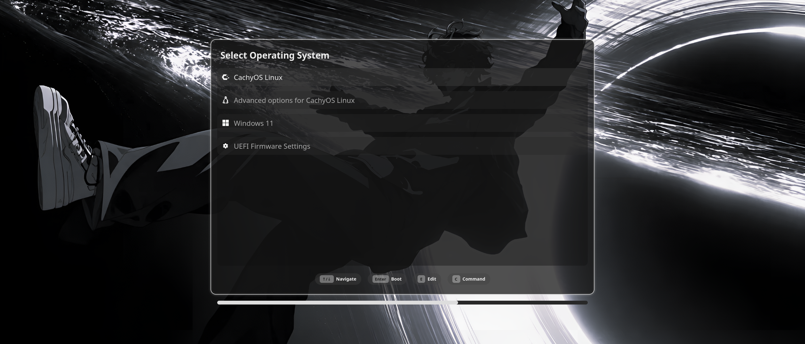
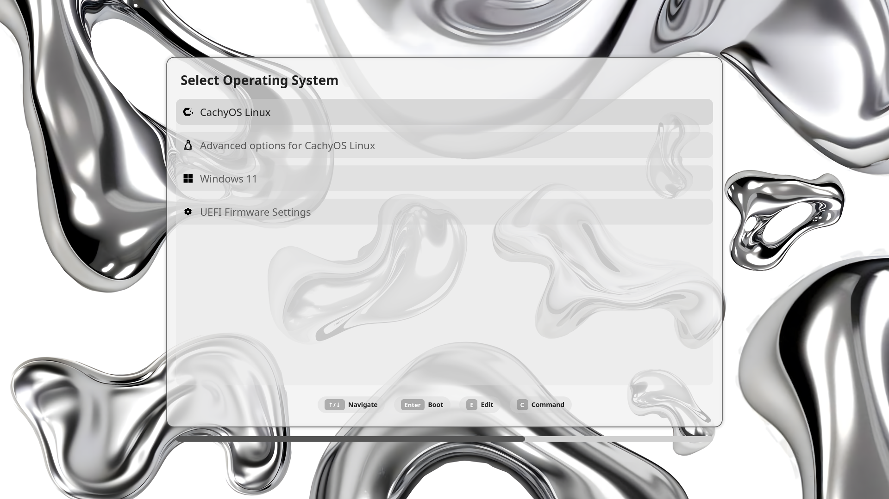

# Adaptive Caelestia GRUB Theme

A GRUB2 theme for Caelestia with a centered panel that keeps its proportions across different display aspect ratios. The wallpaper fills the screen with proportional cropping. Colors and assets automatically sync when you change your Caelestia scheme or wallpaper.

## Previews

Example CachyOS boot entries rendered with dark and light schemes.

<table>
  <tr>
    <th width="50%">21:9 — dark scheme (2560 × 1080)</th>
    <th width="50%">16:9 — light scheme (1920 × 1080)</th>
  </tr>
  <tr>
    <td><a href="preview-21x9.png"></a></td>
    <td><a href="preview-16x9.png"></a></td>
  </tr>
</table>

## Manual installation

Requires a working GRUB2 installation and Caelestia. The scripts target Linux systems using `/boot/grub/grub.cfg`; the dependency commands below are for CachyOS, Arch Linux, and other Arch-based distributions.

1. Install the dependencies:

   ```bash
   sudo pacman -S --needed git grub python python-pillow python-pyqt6
   ```

   For video wallpapers, also install FFmpeg:

   ```bash
   sudo pacman -S --needed ffmpeg
   ```

2. Clone this repository and enter its directory:

   ```bash
   git clone https://github.com/Coastburgh/Adaptive-Caelestia-Grub.git
   cd Adaptive-Caelestia-Grub
   ```

3. Run the installer from your regular user account using `sudo`:

   ```bash
   sudo bash scripts/install.sh
   ```

The installer generates the images and icons, installs the theme in `/boot/grub/themes/caelestia-nexus/`, sets `GRUB_THEME`, and regenerates the GRUB configuration. It also adds Caelestia wallpaper and scheme hooks for automatic updates, including a passwordless sudo rule for the deployment helper. The theme appears at the next boot.

## Manual sync

Wallpaper and scheme changes trigger syncing automatically. To regenerate and deploy the installed theme manually:

```bash
bash ~/.local/share/caelestia-grub/scripts/sync.sh
```

Panel sizing is calculated during generation from the configured GRUB resolution or detected display. Wallpaper cropping and centering are applied by GRUB at boot.

## Uninstallation

From the cloned repository, run:

```bash
sudo bash scripts/uninstall.sh
```

The uninstaller removes the installed theme, local generated files, deployment helper, sudoers rule, and Caelestia sync hooks. It disables this theme's `GRUB_THEME` setting and regenerates the GRUB configuration.

<!--
## Installation with pkgit

Temporarily disabled while this installation method is reviewed.

```bash
pkgit -i https://github.com/Coastburgh/Adaptive-Caelestia-Grub
```
-->
